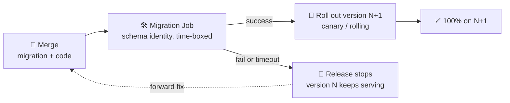
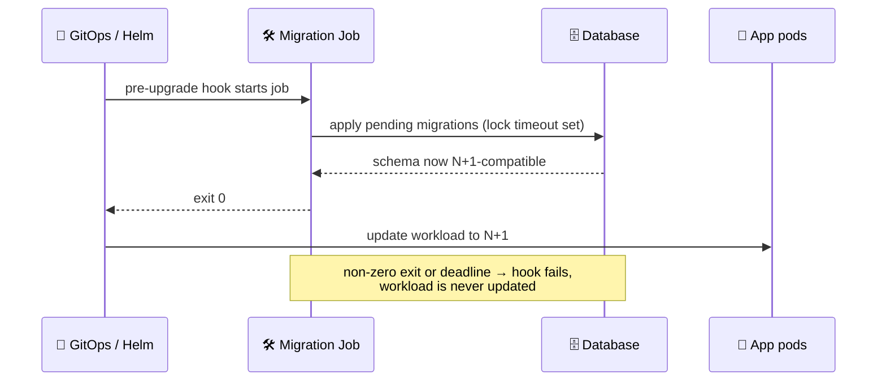
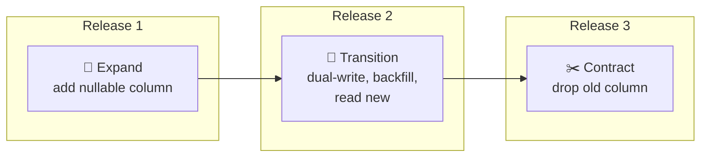
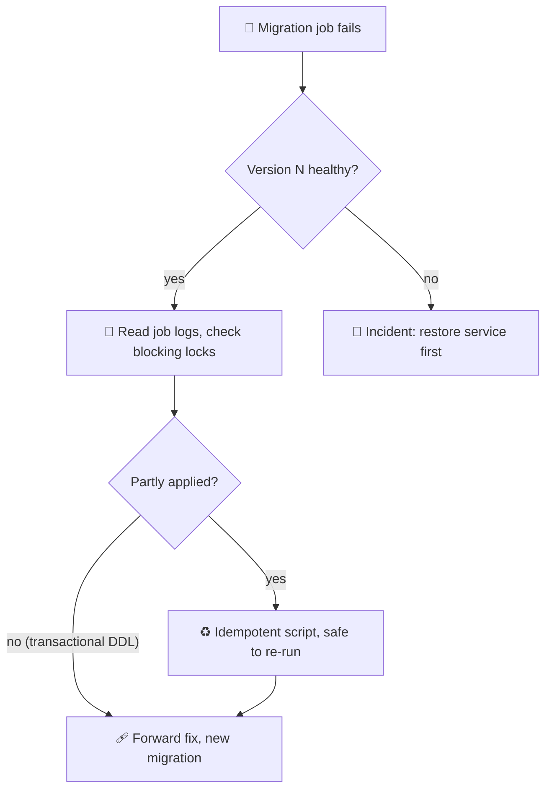

# 🗄️ Database Migrations

Standards for where and when schema migrations run during a release, and how to change a schema without downtime.

## 📖 What are database migrations (as a release concern)?

A migration tool (such as Flyway, Liquibase, Alembic or Goose) knows **how** to apply versioned schema changes and track them. This standard covers **where and when** they run in a release and what compatibility they must keep. The two fit together: the tool is the engine, this standard is the lifecycle around it.

| | Migration engine (the tool) | Migration lifecycle (this standard) |
|---|---|---|
| Scope | Run scripts, checksums, history table | Sequencing, credentials, compatibility, failure handling |
| Runs | In whatever process invokes it | As a separate step before new application pods get traffic |
| Failure | Exits non-zero | Stops the release; the current version keeps serving |

## 🎯 Why it's required

- 🐤 **Safe rollouts:** Two application versions run at once during a canary or rolling update, so the schema must work for both.
- 🏁 **No startup races:** Several replicas auto-migrating on boot can collide or deadlock.
- 🔐 **Least privilege:** Applications should not hold schema-changing rights.
- 🛑 **Predictable failure:** A failed migration should halt a release, not half-start it.

## 👥 Who it's for

- 👩‍💻 **Application developers** who write migrations.
- 🧑‍🔧 **DBAs** who review them.
- 🛠️ **Platform teams** who own the release path.

---

## 🧱 Principles

1. **Run migrations as their own step**, once per release, before the new version receives traffic. Not in application startup.
2. **Stay compatible across adjacent versions.** Version N and N+1 must both work against the schema in between (expand/contract below).
3. **Separate credentials.** The migration step uses a short-lived, schema-changing identity; application pods keep data-only rights.
4. **Bound the step.** Give it a time limit, a low retry count and resource limits, so a lock wait cannot stall a release.
5. **Roll forward.** Fix with a new compatible migration; down-migrations are not a production rollback plan.

## 📍 Where it runs

Recommended: a one-shot job in the deployment platform, triggered before the workload update (a Kubernetes Job run as a pre-upgrade or pre-sync hook). Alternatives:

| Option | Fits when |
|---|---|
| Pre-deploy Job (recommended) | Kubernetes with a Helm or GitOps hook mechanism |
| Pipeline step before deploy | Push-based CD or non-Kubernetes targets; the runner needs a scoped, short-lived DB identity |
| Application startup with a leader lock | Only for small, single-instance services; accept the privilege and race risks |

> ⚠️ **Starting point, not a measured value:** limits of a 5 minute deadline and one retry. A migration that blocks on a lock for longer is usually unsafe to continue, and repeating a partly applied non-transactional change can corrupt state.

## 🔀 Expand / contract

Break a breaking change into releases that are each compatible:

1. 🌱 **Expand:** add the new column or table (nullable or defaulted). Old code ignores it.
2. 🔁 **Transition:** deploy code that writes both, backfill history, then read from the new structure.
3. ✂️ **Contract:** once the old version is gone everywhere, drop the old structure.

Each release is safe to run beside its neighbours, so a canary can hold N and N+1 together at any point.

| Change | Safe approach |
|---|---|
| Rename column | add new, dual-write, backfill, switch reads, drop old later |
| Drop column | stop using it in release N+1, drop in N+2 |
| Add NOT NULL | add nullable, backfill, then add the constraint |
| Add index | use the online or concurrent form where the database offers it |
| Change type | add a new column, sync, cut over |

Set a lock timeout in migration scripts so a blocked statement fails fast instead of queueing behind live traffic.

## ⏪ Failure and rollback

- A failed migration stops the release; confirm version N is still healthy, read the job logs, and check for blocking locks.

- Prefer a forward fix. Use transactional DDL where the database supports it; otherwise make each script idempotent.

## ✅ Checklist

- [ ] Migration runs as a separate step, not at app startup.
- [ ] Time limit, retry limit and resource limits are set.
- [ ] Schema works for both the old and new application version.
- [ ] Migration identity is separate from the runtime identity.
- [ ] Lock timeouts and online index builds are used.

## 🔗 Related Standards

- [Data Architecture](./data-architecture.md): database per service and schema ownership.
- [Progressive Delivery](../release-engineering/progressive-delivery.md): the two-version rollout this compatibility serves.
- [Delivery Models and Promotion](../release-engineering/gitops-promotions.md): where the pre-deploy step sits in the pipeline.
