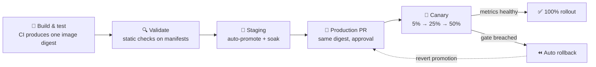
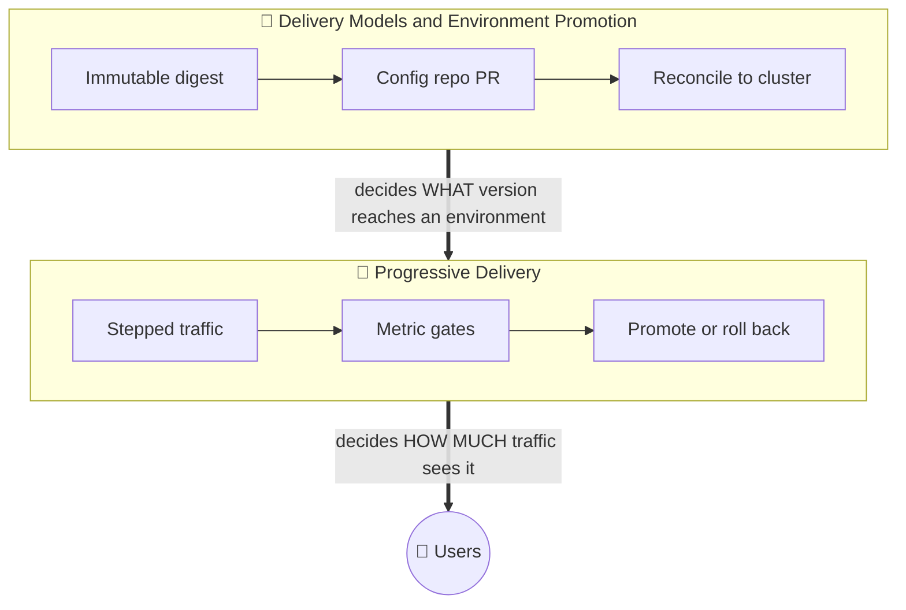

# 🚀 Release Engineering

Standards for getting a built artifact safely into production: how it is delivered and promoted, and how traffic is shifted to it.

## 📖 What is release engineering?

Release engineering covers everything between "the build passed" and "users are on the new version": delivery model, environment promotion, rollout strategy and rollback. It is the bridge between CI (which proves the code works) and operations (which proves it keeps working).

The core idea is to treat a release as a **series of small, reversible, observable steps** rather than a single leap of faith.

## 🎯 Why it's required

Without shared defaults each team invents its own release path, and incidents show it: unreviewed production changes, all-at-once rollouts and slow manual rollbacks.

| Without a standard | With a standard |
|---|---|
| 😰 Friday-evening all-at-once deploys | 🐤 Small slice first, widen while healthy |
| 🧑‍💻 Hand-edited clusters nobody can explain | 📜 Every change maps to a reviewed commit |
| 🐌 Rollback means a rebuild and a redeploy | ⚡ Rollback is a revert or a traffic switch |
| 👀 Someone watches a dashboard and decides | 📊 Declared thresholds decide |

## 👥 Who it's for

- 🛠️ **Platform and SRE teams** who set the defaults.
- 👩‍💻 **Application teams** who follow them and tune thresholds to their service.
- 🔐 **Release engineers and auditors** who verify provenance and approvals.

---

## 📚 Documents

| Standard | What it covers |
|---|---|
| 🐤 [Progressive Delivery](./progressive-delivery.md) | Canary and blue-green strategies, bake windows, metric gates, automated rollback |
| 🔄 [Delivery Models and Environment Promotion](./gitops-promotions.md) | Pull, push and managed delivery; promotion between environments; drift; rollback |
| 🗄️ [Database Migrations](./database-migrations.md) | Where and when schema changes run in a release; expand/contract for zero downtime |

## 🧭 Where to Start

- Rolling out a service gradually? Start with [Progressive Delivery](./progressive-delivery.md).
- Deciding how code reaches a cluster? Start with [Delivery Models and Environment Promotion](./gitops-promotions.md).

## 🏛️ How the two documents fit together

In short: **promotion** answers *which version, where, approved by whom*; **progressive delivery** answers *how many users, how fast, and when to stop*.

## 🧱 Guiding Principles

1. 🔀 **Decouple deployment from release.** Running code and exposing it to users are separate steps.
2. 📊 **Metrics decide.** Promotion and rollback follow declared thresholds.
3. 📜 **Declare, don't hand-edit.** Desired state lives in version control.
4. 🔑 **No long-lived deploy credentials.**
5. 💥 **Contain the blast radius.** Expose a small slice first.

Specific tools are examples, not requirements; each document says when an alternative fits.

## 🔗 Related Standards

- [CI/CD Pipeline](../cicd-pipeline.md) builds the artifact these standards release.
- [Observability](../observability/README.md) supplies the signals behind rollout gates.
- [DevOps](../../overall/devops.md) covers the wider delivery practice.
- [Microservices](../microservices.md) defines the health-check and shutdown contracts rollouts rely on.
