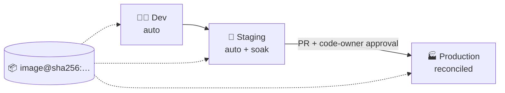
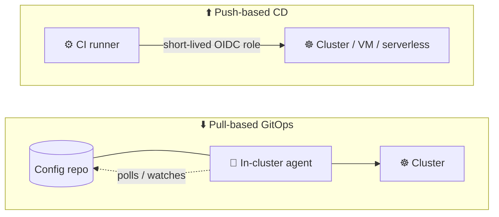
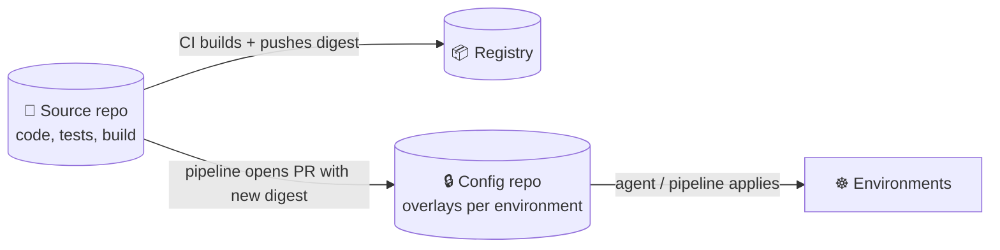
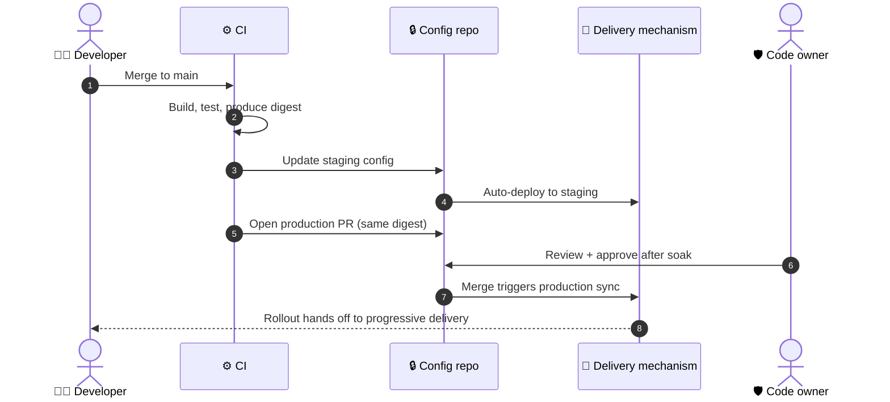
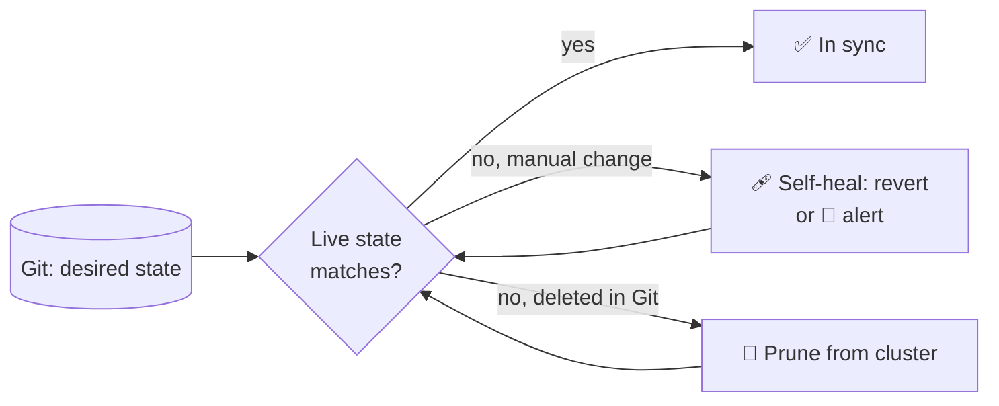
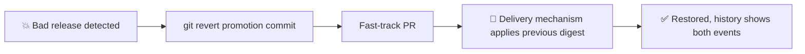

# 🔄 Delivery Models and Environment Promotion

Standards for how a built artifact reaches each environment: the delivery model, promotion between environments, drift control and rollback.

## 📖 What is environment promotion?

Promotion moves one immutable artifact (an image digest plus its configuration) from dev to staging to production, with checks at each step and a recorded, reviewable decision. **GitOps** is one way to do it: desired state lives in Git and an in-cluster agent pulls it. It is the recommended default for Kubernetes, not the only valid model.

The same artifact travels the whole path; only its configuration changes:

## 🎯 Why it's required

- **Auditability:** Every production change maps to a reviewed commit or a logged pipeline run.
- **Reproducibility:** The same digest that passed staging is what reaches production.
- **Credential safety:** Runners do not hold long-lived cluster admin credentials.
- **Drift control:** Out-of-band changes are detected and corrected, or at least reported.

## 👥 Who it's for

- **Platform engineers:** design environments, access and the delivery mechanism.
- **Application teams:** promote releases and own their service configuration.
- **Release engineers and auditors:** define approval gates and verify provenance.

---

## 🧱 Principles

1. **Promote the artifact, not a rebuild.** Reference images by digest, never by a mutable tag such as `latest`.
2. **Declare the desired state.** Configuration is in version control, reviewed like code.
3. **No long-lived deploy credentials.** Use in-cluster pull, or short-lived federated identity.
4. **Separate source from configuration.** Application code and environment config have different owners and change rates.
5. **Roll back by reverting the declaration**, not by hand-editing a cluster.

## 🧭 Choosing a delivery model

Recommended default for Kubernetes: **pull-based GitOps**. Use the others when they fit better.

The practical difference is who initiates the connection to the cluster:

In pull mode nothing outside the cluster holds credentials to it; in push mode the runner is a trust boundary and must be locked down accordingly.

| Model | Use when | Trade-off |
|---|---|---|
| **Pull-based GitOps** (an in-cluster agent such as Argo CD or Flux) | Kubernetes workloads that want continuous reconciliation and no inbound access | Another system to run; ephemeral or synchronous flows are awkward |
| **Push-based CD with federated identity** (a CI runner assuming a short-lived, namespace-scoped role via OIDC) | Preview environments, mixed targets (VMs, serverless), or releases that need synchronous post-deploy tests | The runner is a trust boundary; no continuous drift correction |
| **Managed cloud pipeline** (a cloud provider's delivery service) | The team is committed to one cloud and wants managed approvals and IAM | Provider lock-in; less portable |

For push-based CD, the minimum bar is: no static kubeconfig or keys, credentials that expire within the job, access scoped to the target namespace (never cluster-admin), one deployment at a time per environment, and an audit trail from the cluster back to the pipeline run.

## 🗂️ Repository topology

Keep application source and environment configuration in separate repositories (or at least separate protected paths):

- **Source repo:** code, tests, build definition. Developers merge freely.
- **Configuration repo:** manifests and per-environment overlays. Production is protected: no direct commits.

Packaging (plain overlays, Helm, or another engine) is a team choice. Prefer overlays for in-house services, whose diffs stay readable in review, and charts for reusable or third-party packages that need a values schema.

## 🪜 Promotion flow

1. **Build and test** in the source repo; produce one immutable image digest.
2. **Validate** the manifests statically before promotion (for example with `deployment-validator --mode=static`).
3. **Staging:** the pipeline records the digest in the staging configuration; it deploys automatically.
4. **Production:** a pull request carries the exact digest proven in staging. It needs code-owner approval and a passed staging soak. See [Progressive Delivery](./progressive-delivery.md) for the rollout itself.
5. **Reconcile:** merging the pull request triggers the deployment.

Automation does not commit straight to production configuration.

## 🔁 Drift and reconciliation

When using a reconciling agent:

- Enable self-healing so manual changes are reverted (or at minimum alerted on).
- Enable pruning so resources deleted from Git are removed from the cluster.
- Order dependent resources (namespaces and identity before config, migrations before workloads, workloads before routing).

## ⏪ Rollback

Revert the promotion commit (or re-run the pipeline with the previous digest) and let the delivery mechanism apply it. History then records both the failed release and the fix. Avoid `kubectl` edits to production.

> 💡 For an urgent incident, progressive delivery's automatic traffic rollback is the first line of defence; reverting the promotion makes that rollback permanent.

## 🚫 Anti-patterns

| Anti-pattern | Why it hurts | Instead |
|---|---|---|
| Static cluster tokens in CI | A leaked token bypasses review | In-cluster pull or federated short-lived identity |
| Source and config in one repo | Build loops and tangled permissions | Separate repos or protected paths |
| Mutable tags | Cannot verify or reproduce what ran | Digest references |
| Self-healing disabled | Drift goes unnoticed | Enable it, or alert on drift |

## 🔗 Related Standards

- [Progressive Delivery](./progressive-delivery.md): controlled rollout once a promotion merges.
- [CI/CD Pipeline](../cicd-pipeline.md): produces the artifact that is promoted.
- [DevOps](../../overall/devops.md): the wider delivery practice this builds on.
- [Observability](../observability/README.md): signals that gate promotion.
