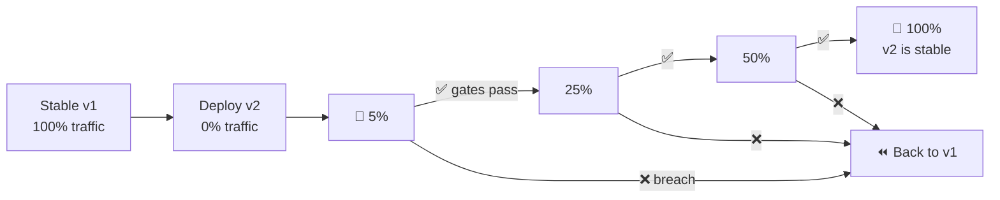
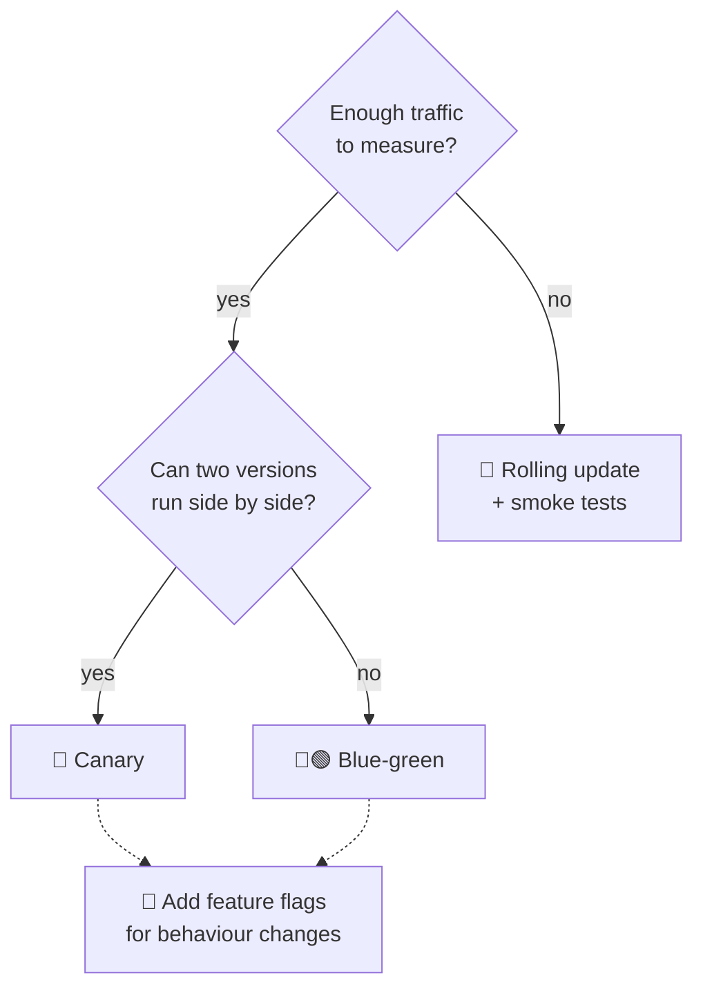
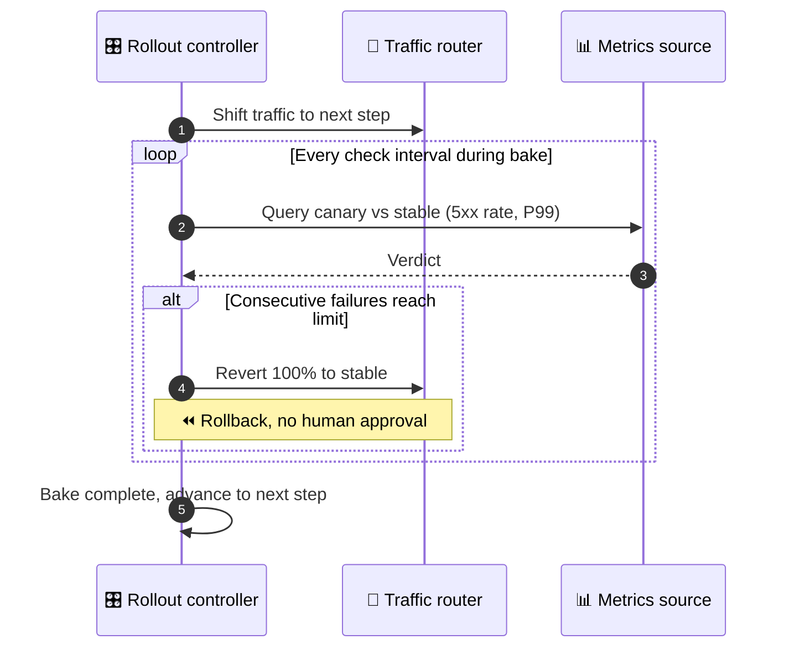
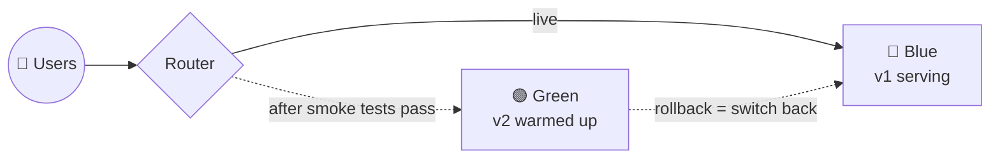

# 🐤 Progressive Delivery

Standards for canary and blue-green releases, metric-driven promotion gates, and automated rollback.

## 📖 What is progressive delivery?

Progressive delivery releases a new version to a small, bounded slice of production traffic first, checks live telemetry against a baseline, and widens exposure only while the checks hold. If they fail, traffic returns to the stable version automatically. Deployment (code is running) and release (users reach it) become separate steps.

Think of it as a dimmer switch instead of a light switch: exposure rises in small steps, and each step must earn the next one.

## 🎯 Why it's required

- **Contained blast radius:** A defect reaches a small share of users, not all of them.
- **Objective promotion:** Error-rate and latency data decide, not a person watching a dashboard.
- **Fast recovery:** Rollback is a traffic change, not a rebuild.
- **Safe cadence:** Teams ship often because a bad release is cheap to undo.

## 👥 Who it's for

- **Platform and SRE teams:** choose the rollout mechanism and own the default analysis gates.
- **Service owners:** set steps, bake times and thresholds for their service.
- **Release engineers:** wire promotion into the delivery pipeline (see [Delivery Models and Environment Promotion](./gitops-promotions.md)).

---

## 🧱 Principles

1. **Decouple deployment from release.** Running code and routing users to it are separate decisions.
2. **Start small.** The first step exposes a small share of traffic so a failure is cheap.
3. **Metrics decide.** Promotion and rollback follow thresholds declared in version control.
4. **Roll back automatically.** A breach reverts traffic without waiting for approval.
5. **Run two versions side by side.** Schemas and APIs must stay compatible across adjacent versions, which is why [database migrations](../data/database-migrations.md) use expand/contract.

## 🧭 Choosing a strategy

Recommended default: **canary**. Use the others when canary does not fit.

| Strategy | Use when | Trade-off |
|---|---|---|
| **Canary** | Stateless services with enough traffic to measure | Slowest; needs good telemetry |
| **Blue-green** | Breaking state changes, or work that cannot tolerate a traffic split | Needs a full second environment; cutover is all at once |
| **Rolling update** | Low-risk internal services, or too little traffic for statistics | No metric gate; rollback means redeploying |
| **Feature flags** | Behaviour must change independently of the deployment | Flag hygiene; complements the others rather than replacing them |

## 🐤 Canary progression

Stepped exposure with a bake window per step; no direct jump from 0% to 100% in production. Values are a starting point; tune them to the service's traffic and SLO.

| Step | Traffic | Bake | Looking for |
|---|---|---|---|
| Seed | ~5% | ~10 min | crash loops, failed startup |
| Initial | ~25% | ~15 min | throughput, dependency capacity |
| Half | ~50% | ~20 min | latency stability, pool saturation |
| Full | 100% | ~15 min | final check before the old version is removed |

Lower environments may compress bake windows to a few minutes.

Each bake window runs the same loop:

## 🔵🟢 Blue-green cutover

Cut over only when the standby environment passes its smoke tests and reports healthy readiness. Switch traffic atomically and keep the previous environment idle for a defined period so rollback is a switch back.

> 💡 **Tip:** keep the idle environment's capacity and data connections warm for the whole retention period, or the "instant" rollback will not be instant.

## 🚦 Rollback gates

Gate every bake window on both error rate and latency, measured on the canary against the stable baseline:

- **Error rate:** HTTP 5xx rate stays under an agreed ceiling (a team starting point is 0.1%).
- **Latency:** P99 stays within an agreed multiple of stable (a team starting point is 1.15x).
- **Traffic floor:** ignore verdicts below a minimum request rate, to avoid false results on small samples.
- **Failure tolerance:** roll back after consecutive failed checks, not on a single blip.
- **Warm-up:** start evaluating after pods are ready, to skip cold-start noise.

> ⚠️ These starting points are the team's defaults, not industry constants. Anchor them to the service SLO (see [SLOs](../observability/README.md)).

## 🧰 Tooling

Any rollout controller that can shift traffic in steps, query a metrics source and revert on failure meets this standard. Choose by what the platform already runs:

| Option | Fits when |
|---|---|
| Argo Rollouts | The platform already uses Argo CD |
| Flagger | The platform uses Flux, or teams must keep plain `Deployment` objects |
| Ingress or mesh weights driven by the pipeline | No controller can be installed |

Metrics can come from Prometheus, a commercial APM, or a cloud monitoring service, as long as the gate queries can express the thresholds above.

## ✅ Checklist

- [ ] Strategy chosen and justified for the service.
- [ ] Steps, bake times and thresholds are declared in version control.
- [ ] Error-rate and latency gates both exist.
- [ ] Gate queries were tried against staging data.
- [ ] Traffic reverts to stable if the rollout controller itself fails.
- [ ] Schema changes are backward compatible across adjacent versions.

## 🔗 Related Standards

- [Delivery Models and Environment Promotion](./gitops-promotions.md): how a release reaches each environment.
- [Observability](../observability/README.md): metrics and SLOs that feed the gates.
- [CI/CD Pipeline](../cicd-pipeline.md): builds the artifact being rolled out.
- [Database Migrations](../data/database-migrations.md): schema compatibility during dual-version running.
